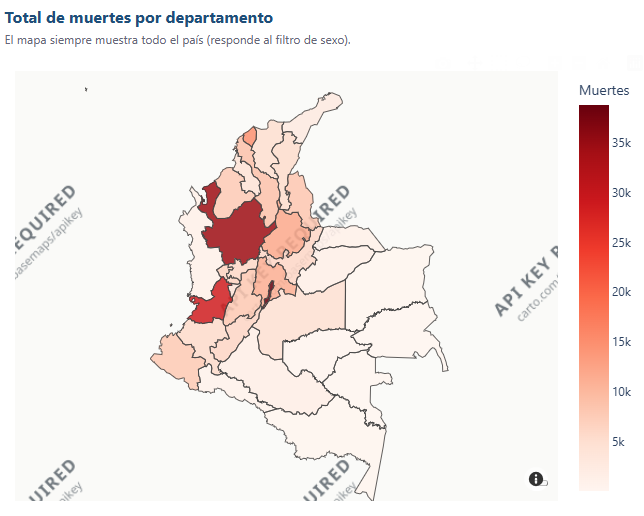
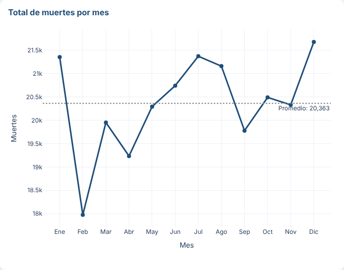
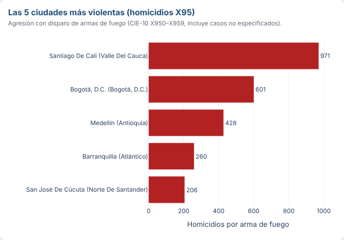
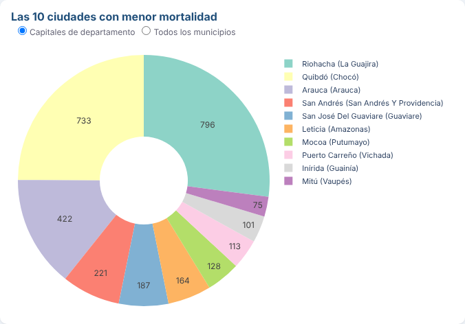
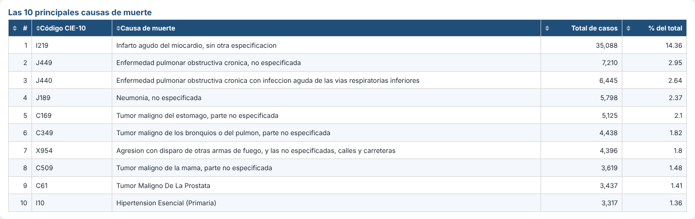
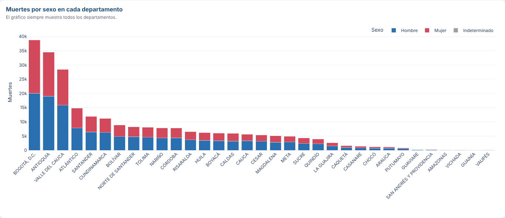
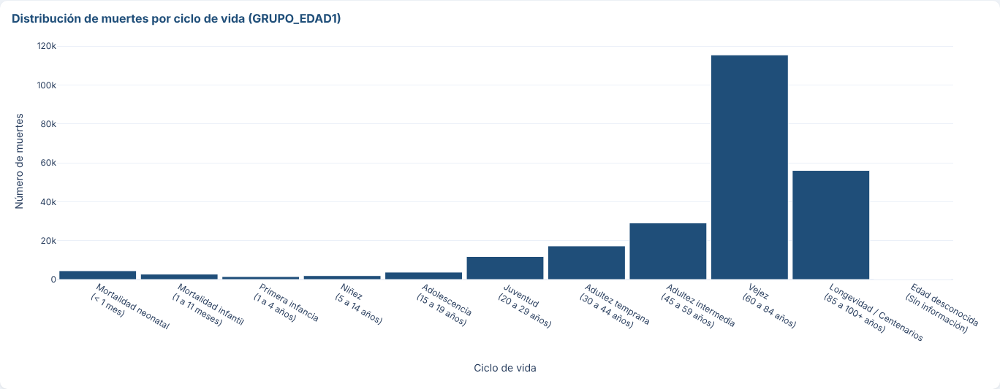

# Mortalidad en Colombia 2019 – Aplicación web dinámica con Dash

**Integrantes:** Oscar Felipe Rendón Cruz · _(agregar los demás integrantes)_
**Aplicación desplegada:** https://actividad4-mortalidad2019.onrender.com _(confirmar con la URL que asigne Render)_
**Repositorio:** https://github.com/Feliperendonc/actividad4_mortalidad2019

## 1. Introducción

Aplicación web interactiva construida en Python con **Plotly** y **Dash** para explorar las
defunciones no fetales registradas en Colombia durante 2019 (244.355 registros), a partir de los
microdatos de Estadísticas Vitales (EEVV) del DANE. La aplicación integra un mapa, gráficos de
líneas, barras, barras apiladas, circular, histograma y una tabla, con filtros por departamento
y sexo, y está desplegada en una plataforma como servicio (PaaS) – Render.

## 2. Objetivo

Identificar patrones demográficos, temporales y regionales de la mortalidad en Colombia en 2019:
dónde se concentran las muertes, cómo varían a lo largo del año, cuáles son las principales causas,
qué ciudades concentran los homicidios con arma de fuego y cómo se distribuyen las muertes por
sexo y ciclo de vida.

## 3. Estructura del proyecto

```
actividad4_mortalidad2019/
├── app.py                      # Aplicación Dash (layout + callbacks). Expone `server` para gunicorn
├── prepare_data.py             # Convierte los Excel del DANE en CSV livianos (se ejecuta una vez)
├── requirements.txt            # Dependencias con versiones fijas
├── Procfile                    # Comando de arranque (Render / Railway / Heroku)
├── render.yaml                 # Configuración opcional "Blueprint" de Render
├── .python-version             # Versión de Python para el despliegue
├── assets/
│   └── style.css               # Estilos (Dash los carga automáticamente)
├── data/
│   ├── raw/                    # Archivos originales: NoFetal2019.xlsx, CodigosDeMuerte.xlsx, Divipola.xlsx
│   ├── mortalidad_2019.csv.gz  # Registros de defunción (columnas usadas)
│   ├── causas_muerte.csv       # Diccionario CIE-10 (códigos de 3 y 4 caracteres)
│   ├── divipola.csv            # Departamentos y municipios
│   ├── centroides_departamentos.csv  # Lat/Lon promedio por departamento (mapa de respaldo)
│   └── colombia_departamentos.geojson # Polígonos de departamentos (se descarga automáticamente)
└── screenshots/                # Capturas usadas en este README
```

### Procesamiento de datos

* Los registros se unen con la **DIVIPOLA** por `COD_DANE` (municipio) y `COD_DEPARTAMENTO`.
* Las causas se describen con el catálogo **CIE-10** usando el código de 4 caracteres (o de 3 cuando el registro solo trae 3).
* **Homicidios:** códigos `X950–X959` (agresión con disparo de armas de fuego, incluidos los no especificados).
* **Menor mortalidad:** como los archivos no incluyen población, se usa el **número total de muertes**. Por defecto se comparan las **capitales de departamento** (código de municipio `001`; Bogotá D.C. = `11001`); un selector permite cambiar a todos los municipios.
* **Ciclo de vida:** `GRUPO_EDAD1` se agrupa según la tabla de referencia (neonatal 0–4, infantil 5–6, primera infancia 7–8, niñez 9–10, adolescencia 11, juventud 12–13, adultez temprana 14–16, adultez intermedia 17–19, vejez 20–24, longevidad 25–28, desconocida 29).

## 4. Requisitos

| Librería   | Versión |
|------------|---------|
| Python     | 3.12    |
| dash       | 2.18.2  |
| plotly     | 5.24.1  |
| pandas     | 2.2.3   |
| numpy      | 2.1.3   |
| gunicorn   | 23.0.0  |
| openpyxl   | 3.1.5 (solo para `prepare_data.py`) |

## 5. Software

Python 3.12 · Dash · Plotly Express · pandas · Gunicorn · Git/GitHub · Render (PaaS) · VS Code.

## 6. Instalación (ejecución local)

```bash
git clone https://github.com/Feliperendonc/actividad4_mortalidad2019.git
cd actividad4_mortalidad2019
python -m venv venv
# Windows: venv\Scripts\activate      macOS/Linux: source venv/bin/activate
pip install -r requirements.txt
python app.py
```

Abrir http://127.0.0.1:8050. Los CSV procesados ya vienen en `data/`; solo si se cambian los
Excel originales hay que regenerarlos con `python prepare_data.py`.

## 7. Despliegue en Render

1. Subir el proyecto a un repositorio **público** de GitHub.
2. Crear una cuenta en https://render.com (se puede ingresar con GitHub).
3. **New + → Web Service** → conectar el repositorio.
4. Configurar:
   * **Language/Runtime:** Python 3
   * **Build Command:** `pip install -r requirements.txt`
   * **Start Command:** `gunicorn app:server --workers 1 --threads 4 --timeout 120`
   * **Instance type:** Free
   * **Environment variable:** `PYTHON_VERSION = 3.12.7`
5. **Create Web Service**. Al terminar el build, Render publica la URL `https://<nombre>.onrender.com`.
6. Cada `git push` a la rama principal vuelve a desplegar la aplicación automáticamente.

> En el plan gratuito el servicio "se duerme" tras 15 min sin visitas; la primera carga puede tardar ~50 s.

## 8. Visualizaciones y resultados

### Mapa – Total de muertes por departamento


Mapa coroplético: cuanto más oscuro el departamento, más defunciones. **Bogotá D.C. (38.760),
Antioquia (34.473) y Valle del Cauca (28.443)** concentran el 41,6 % de las muertes del país, lo
que refleja principalmente su tamaño poblacional. Los departamentos de la Orinoquía y Amazonía
(Vichada, Guainía, Vaupés) registran menos de 200 muertes cada uno.

### Gráfico de líneas – Muertes por mes


El promedio es de ~20.360 muertes por mes. **Febrero** es el mínimo (17.974, en parte por tener
menos días) y **diciembre** el máximo (21.678), seguido de julio y enero. La variación entre meses
es moderada (±7 % respecto al promedio).

### Gráfico de barras – 5 ciudades más violentas


Se registraron 9.273 homicidios con arma de fuego (X95), el 93,5 % en hombres. **Cali (971)**
encabeza la lista, por encima de Bogotá (601), Medellín (428), Barranquilla (260) y Cúcuta (206);
estas cinco ciudades suman el 27 % de los casos del país.

### Gráfico circular – 10 ciudades con menor mortalidad


Entre las capitales de departamento, las de menor número de muertes son **Mitú, Inírida, Puerto
Carreño, Mocoa, Leticia y San José del Guaviare**, capitales de departamentos poco poblados.
Con el selector "Todos los municipios" aparecen municipios pequeños con una sola defunción.

### Tabla – 10 principales causas de muerte


El **infarto agudo de miocardio (I219)** es por mucho la primera causa (35.088 casos, 14,4 %).
Le siguen la EPOC (J449, J440), la neumonía (J189) y varios tumores malignos (estómago, pulmón,
mama, próstata). La **agresión con arma de fuego (X954)** es la séptima causa del país.

### Barras apiladas – Muertes por sexo en cada departamento


En todos los departamentos mueren más hombres que mujeres (55,1 % vs. 44,9 % a nivel nacional).
La brecha es mínima en Bogotá (1,07 hombres por cada mujer) y máxima en **Guaviare (3,4)**,
Guainía, Amazonas, Vichada y Putumayo, departamentos con mayor incidencia de muertes violentas.

### Histograma – Ciclo de vida (GRUPO_EDAD1)


La mortalidad se concentra en la **vejez (60–84 años, 47 %)** y la **longevidad (85+, 23 %)**.
Entre los grupos jóvenes destaca la **juventud (20–29 años, 4,8 %)**, superior a la adolescencia
y la niñez, lo que se asocia con causas externas (homicidios y accidentes). La mortalidad
neonatal (1,8 %) supera a la de la infancia y la niñez.

## Fuente

DANE – Estadísticas Vitales (EEVV) 2019: defunciones no fetales, catálogo CIE-10 y DIVIPOLA.
Polígonos de departamentos: GeoJSON público de Colombia (john-guerra, GitHub Gist).
